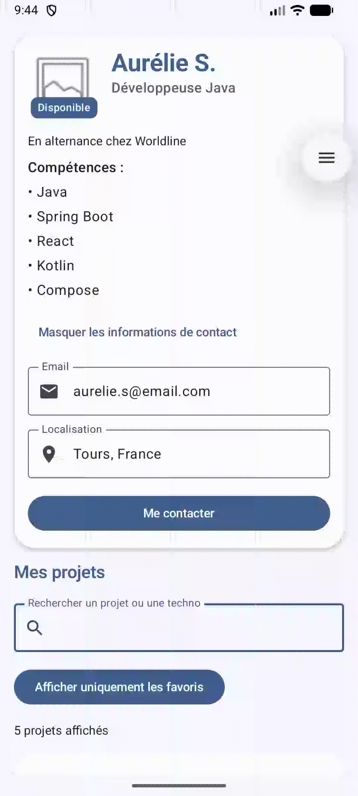
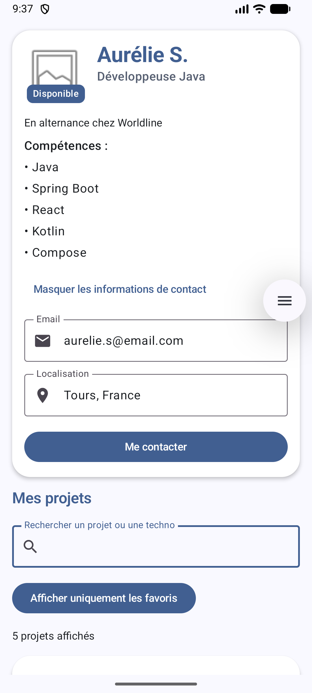
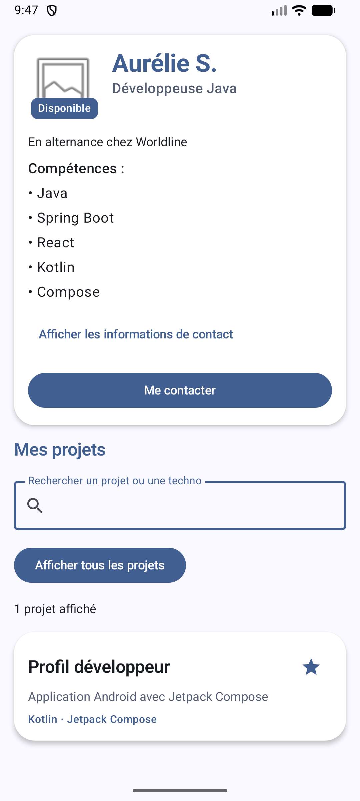

# Profil développeur intéractif – v3

Application Jetpack Compose qui affiche le profil d'une développeuse.
La v3 implémente la recherche d'un projet par son titre, sa description ou une de ses technologies, l'ajout ou le retrait des projets en favori, l'affichage des favoris et le compteur des projets selon la sélection.
Les données sont locales.

## États gérés par l'application

- texte de recherche
- filtre des favoris
- identifiants des projets favoris
- liste des projets affichés

## État local

L'affichage des informations de contact est géré directement dans `ProfileCardContent`. L'affichage du contact ne sert qu'à la carte de profil, je l'ai donc laissé dans le composable avec `rememberSaveable`, au lieu de le mettre dans le ViewModel.

## State Hoisting

`ProfileScreen` peut être défini comme stateless puisqu'il ne garde aucun état. Il reçoit en paramètres ce qu'il doit afficher et transmet les actions de l'utilisateur.

## ViewModel

`ProfileViewModel` gère l'état principal de l'écran. C'est lui qui définit la liste à afficher et actualise l'état selon chaque action de l'utilisateur.

## StateFlow

Avec `MutableStateFlow`(privé), le ViewModel est le seul à pouvoir modifier l'état. L'écran ne peut pas modifier l'état mais ne peut que le lire, avec `StateFlow` public.
Quand l'utilisateur fait une action, le ViewModel crée un nouvel état avec `update` et `copy`.
Le container l'observe avec `collectAsState()` et Compose met à jour l'écran avec les nouvelles valeurs selon l'état.

```
ProfileViewModel
     │ publie un état (StateFlow)
     ▼
ProfileContainer
     │ collecte l'état (collectAsState)
     ▼
ProfileScreen
     │ action de l'utilisateur
     ▼
ProfileViewModel
```

## Organisation du code

- `ProfileViewModel` : gère l'état et les actions
- `ProfileUiState` : l'état de l'écran
- `ProfileContainer` : relie le ViewModel à l'écran
- `ProfileScreen` : affiche l'écran, sans état
- `ProfileCard` : la carte de profil, avec l'état local du contact
- `ProjectCard` : la carte d'un projet, avec son bouton favori
- `ProjectSearchField` : le champ de recherche

## Démo vidéo

*Cliquez sur la démo pour la lancer si elle ne démarre pas automatiquement.*



## Captures d'écran






